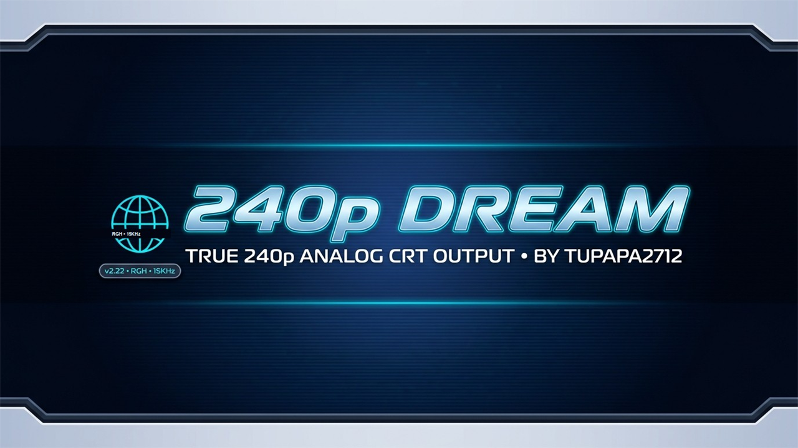

<p align="center">
  
</p>

<h1 align="center">Xbox 360 Native 240p — <code>t240.xex</code> (v2.30) &amp; 240p Dream</h1>

<p align="center">
  <strong>True 240p analog CRT output for Xbox 360 RGH and BadUpdate + Plug-and-Play Retro Emulator</strong><br/>
  Created by <strong>tupapa2712</strong>
</p>

<p align="center">
  <em>"No matter how much others rely on logic, data, truth, and knowledge, I keep believing in myself."</em>
</p>

<p align="center">
  
  &nbsp;&nbsp;&nbsp;
  
</p>

---

## What is this?

Normally, when you connect an Xbox 360 to a standard-definition tube TV (CRT) using a Component, SCART, or AV cable, the console only outputs a flickering **480i** image.

This free, open-source project unlocks **real 240p output** on Xbox 360 RGH — giving you authentic scanlines, zero flicker, and razor-sharp pixels so retro emulators and Xbox 360 / Arcade games look just like classic consoles on a CRT.

---

## What's New in v2.30

### 240p Dream (Based on Salvia 360 v1.1.2)
- **Native `256x240` & `320x240` Resolutions (Global & Per-Core):** Alongside super-resolutions (`640x240`, `1280x240`, `1920x240`, `2560x240`), `240p Dream` now supports native **`256x240`** and **`320x240`** output — configurable globally in **Video Settings** or individually per emulator in **Core Options** (applied live and saved per core).
- **Automatic `t240.xex` Detection & `480i` Warning:** The Video menu automatically detects whether `t240.xex` is loaded in memory (showing **Active** vs. **Not Detected**) and displays a clear non-blocking notice warning that output will stay in **480i** instead of **240p** if the plugin isn't loaded.
- **Built-in BIOS Downloader & Updated Cores:** Includes a built-in **BIOS downloader** plus updated cores (**Snes9x** with MSU-1 audio, **Atari 2600 / Stella 2014**, **blueMSX**, and **mGBA**), ready for CRT out of the box in **`2560x240`** with crisp pixels.
- **Core Options Before You Play:** Configure **Core Options** for all **10 main cores** (PlayStation, Nintendo 64, Snes9x, Snes9x 2010, mGBA, Genesis Plus GX, Nestopia, Gambatte, Stella 2014, and blueMSX) directly from the crisp **480i main menu (`Options → Core Options`)** before launching a game — or in-game anytime with **`Select + Y`**.
- **PlayStation Controller Choice & Vibration:** Choose between **Standard (Digital)** and **DualShock** controllers for PlayStation 1 right from Core Options, and enjoy **controller vibration (Rumble)** in both **PlayStation 1** (with DualShock) and **Nintendo 64**, with automatic vibration stop when pausing or exiting.
- **Improved Nintendo 64 Display:** N64 games now display centered, full-screen, and razor-sharp in `2560x240`.
- **Instant Exit to 480i Menu:** Press **`LB + RB + LT + RT`** inside any retro game to exit straight back to the main menu cleanly in **480i**.

### `t240.xex` Plugin (Native Xbox 360 & XBLA Games)
- **Direct `2560x240` with One Combo:** No external scripts, selectors, or popups needed. Just press **`LT + RT + L3 + R3`** inside any Xbox 360 or Arcade game to switch between **`2560x240`** and **`480i`**.
- **Clean & Lag-Free Switching:** Smooth, stable return to **480i** with zero on-screen popups and zero added input lag.
- **Stealth Server Compatible (Native & XBLA Only):** `t240.xex` works alongside Xbox Live Stealth server plugins (such as **xbGuard**, **Proto**, etc.) when playing **native Xbox 360 and XBLA games**. *(Note: **`240p Dream`** is **NOT** compatible with Stealth servers — disable your Stealth plugin before launching the emulator or the console will shut down.)*

---

## Easy Setup & How to Use

### What You Need
* **Xbox 360 with RGH or BadUpdate** (Kernel **17559**)
* **CRT TV** connected via S-video, Component, SCART, or AV cable (set Xbox display to **480i**)
* **DashLaunch** and **Aurora Dashboard**

> **Stealth Server Compatibility:**
> - **`t240.xex` (Native Xbox 360 & XBLA games):** **Compatible** with Xbox Live Stealth servers (such as **xbGuard**, **Proto**, etc.) when loaded in its own free plugin slot in `launch.ini` (for example, `plugin5`).
> - **`240p Dream` (Retro Emulator):** **NOT compatible with Stealth servers** — launching `240p Dream` with a Stealth plugin active will **shut down the console**. Disable your Stealth server plugin in `launch.ini` before opening `240p Dream`.
> - **Tip (One-Click Toggle from Aurora):** If you don't want to enable and disable your stealth server manually in DashLaunch every time, you can use my Aurora utility script **[Aurora-Toggle-xbGuard](https://github.com/Tupapa2712/Aurora-Toggle-xbGuard)** to toggle it ON/OFF with a single button right from Aurora.
>
> **Note:** No copyrighted ROMs or BIOS files are included in the ZIP. You can use the built-in BIOS downloader in `240p Dream` or add your own legally dumped games and BIOS files.

### 3-Step Installation
1. **Download the files** from the [Releases](https://github.com/Tupapa2712/xbox360-240p-plugin/releases) page:
   * `t240.xex`
   * `240p-Dream-v2.30-Complete-NoROMs-NoBIOS.zip`
2. **Install `t240.xex`:**
   * Copy `t240.xex` to your console (e.g., `Hdd:\AuroraLaunch\Plugins\t240.xex`).
   * Open **DashLaunch** (or edit `Hdd:\launch.ini`) and assign a free plugin slot: `plugin3 = Hdd:\AuroraLaunch\Plugins\t240.xex`
   * Save and **reboot** your console.
3. **Install `240p Dream`:**
   * Extract `240p Dream` to your emulators folder (e.g., `Hdd:\Emulators\240p Dream\`).
   * Drop your games into the pre-created folders under `240p Dream\roms\<system>\`, and use the built-in BIOS downloader (or copy RetroArch BIOS files into `240p Dream\system\`).
   * Scan your content paths in **Aurora** — cover art, banner, background, and icon load automatically.

### Quick Controls
| Where | How it Works | Button Combo |
| :--- | :--- | :--- |
| **240p Dream (Emulators)** | **100% Automatic.** Menus stay in clear **480i**; games switch automatically to **240p**. | **`LB + RB + LT + RT`** *(exit game & return to 480i menu)* |
| **240p Dream (In-Game Menu)** | Open the in-game menu anytime (or configure Core Options in 480i before playing). | **`Select + Y`** *(open/close in-game menu)* |
| **Native Xbox 360 / XBLA** | Launch your game from Aurora in **480i**, then toggle in-game. | **`LT + RT + L3 + R3`** *(toggle **`2560x240`** ↔ **`480i`**)* |

### Important Tips for Players
1. **Xbox 360 & XBLA loading screens, menus & level changes:**
   - Start native Xbox 360 and XBLA games from Aurora in **480i**, then press **`LT + RT + L3 + R3`** once you are in the game.
   - **If a game gets stuck on a loading screen, menu, or level transition while in 240p:** press **`LT + RT + L3 + R3`** to switch back to **480i** so it can move forward, and press **`LT + RT + L3 + R3`** again once gameplay continues.
2. **Stealth Server Compatibility:** `t240.xex` v2.30 works with Stealth servers (like **xbGuard** or **Proto**) **only for native Xbox 360 and XBLA games**. For **`240p Dream`**, you must **disable** your Stealth server plugin in `launch.ini` first — otherwise the console will shut down when launching the emulator. *(Tip: use **[Aurora-Toggle-xbGuard](https://github.com/Tupapa2712/Aurora-Toggle-xbGuard)** to toggle your stealth server ON/OFF in one click from Aurora without editing DashLaunch manually).*
3. **Turning Off Safely:** Switch back to **480i** before shutting down; if you use the physical power button while in 240p, wait 5–10 seconds for the console to restore 480i and power off cleanly.

---

### Why isn't 240p activating on your console?

If you followed the steps and neither **240p Dream** nor your games switch to 240p, check these 5 common causes:

1. **HDMI or Component cable set to HDTV (480p):** This plugin only works over analog SDTV (480i) output—it does not work over HDMI or HDMI-to-AV/RCA adapters. If you use a Component cable, make sure the physical switch on the connector is set to **TV** (not **HDTV**); otherwise the console outputs 480p and 240p will not activate.
2. **Console set to 50 Hz (PAL-50):** The plugin is designed for 60 Hz output (NTSC or PAL-60). If your console is set to 50 Hz, switch your Xbox 360 display setting to 60 Hz (PAL-60).
3. **Unsupported kernel or motherboard:** It is only tested and supported on **Retail Kernel 17559** (on consoles with a HANA chip such as Slim / Corona). On other kernel versions or older Xenon motherboards (which use the earlier ANA chip), it may not work the same way.
4. **Wrong path or wrong `launch.ini` file:** In the `launch.ini` file your console loads, the plugin path must start with `Hdd:\` (never `Hdd1:\`). Also, if you use USB / BadUpdate methods (such as XeUnshackle or FreeMyXe), a `Usb:\launch.ini` file can take priority over `Hdd:\launch.ini` and prevent the plugin from loading if you edited the wrong file.
5. **Quick way to check if the plugin loaded:** Open **240p Dream** -> **Options** -> **Video** and check that it shows `Plugin t240.xex: Active`. If it says `Not Detected`, the plugin did not load from your `launch.ini`.

---

## Official v2.30 SHA-256 Checksums

<details>
<summary><strong>Click to expand: Official v2.30 SHA-256 Checksums</strong></summary>

| File | Size | SHA-256 |
|---|---|---|
| `t240.xex` (v2.30) | `102,400` B | `BF428062E2BAB19A144B117F051BCC5AB682240CF2C5F3BF1155808B129F7C50` |
| `240p-Dream-v2.30-Complete-NoROMs-NoBIOS.zip` | `292,488,510` B | `896770507318B344B25162C7E0C29C6C307EBCBF64B0667EFC2976C7D0680178` |
| `default.xex` (240p Dream) | `8,134,656` B | `C587CF2033838B92B59FE6C88A841577FB777753B19DF18460ED0A10A85EB398` |
| `pcsxr-360.xex` (PlayStation) | `23,425,024` B | `5650DB4D1D85693EED86C4F897D23A1104E0C1C6904E40AF7A63D1A9F6A7CC9E` |
| `xbox64.xex` (Nintendo 64) | `9,310,208` B | `F705AD6C81C2CF698152D5C03F3E8A1418948C688C0ED57E665AFA4098F96934` |
| `Snes9x.xex` (SNES MSU-1) | `10,436,608` B | `F558160F6734D3FD88A74AFBF0EB6C05A3ECCA8EE6753D9DD0D3B8B5040F48F3` |
| `Snes9x2010.xex` (SNES) | `10,465,280` B | `92DB20F22F4D3FB6F1B94D16D0CC798BD0EDC22D309D5B34A0C67AD7CDB83E49` |
| `Nestopia.xex` (NES) | `11,350,016` B | `BA87325E8B2AA9989F3F227C514025D1F07D981438EF89A148E94A092F3A95A4` |
| `Genesis-Plus-GX.xex` (Genesis/MD) | `12,378,112` B | `DD6E6BA2BB33518462F2C48E1C344560DDF4D3CCD28FD49E0D20FEB583A2A270` |
| `mgba.xex` (GBA) | `9,973,760` B | `2881C7FBAEFB949D0F2CCB9AB922015E3DBD80B3041108809BD7E3621EDB139D` |
| `Gambatte.xex` (GB/GBC) | `9,445,376` B | `05B057A745D4EB0B86A713CF309CBE1C5544F206FF503203FA31AD8DB2C59253` |
| `stella2014.xex` (Atari 2600) | `9,248,768` B | `6999093F93020837F611D581B5EF6E080614BB8C8F7CBB63B3579B0D12DFC161` |
| `blueMSX.xex` (MSX/MSX2) | `9,416,704` B | `A3C9701BB8E64B0F9858BEB425B58515E962A4420B70C813B82A9D7306432841` |

</details>

---

## Building from Source

Requires the **Microsoft Xbox 360 SDK (XEDK)** and full **Visual Studio 2010** (Visual Studio Express is not supported):

```bat
build.bat
```

Outputs `build\t240.xex`.

## License & Credits

- **`t240.xex`:** Open-source Xbox 360 240p DashLaunch plugin by **tupapa2712**.
- **`240p Dream`:** CRT-focused fork of **[Salvia 360](https://github.com/danibiker/Salvia)** (v1.1.2) by **danibiker**, licensed under **GNU AGPL v3.0** (see `LICENSE` and `licenses/`).
