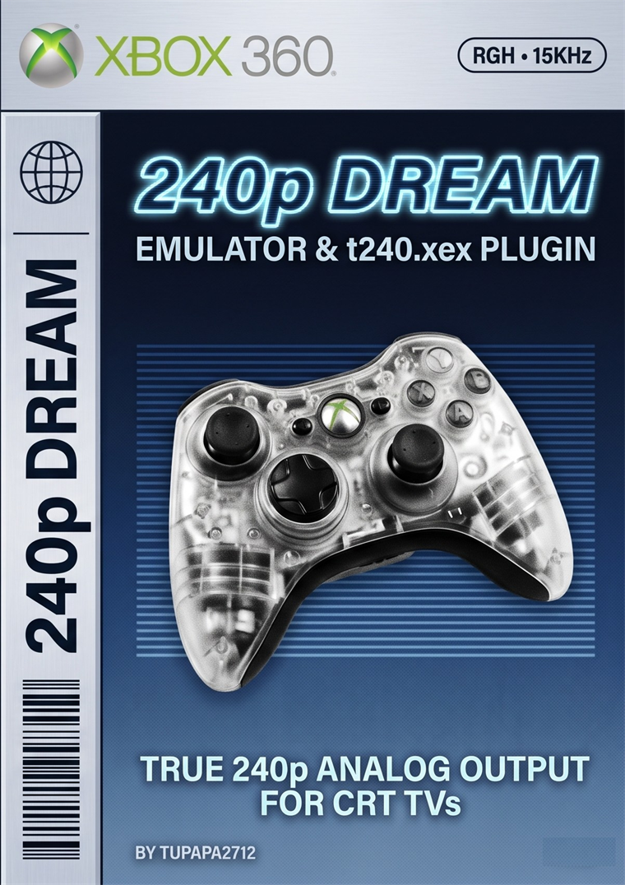
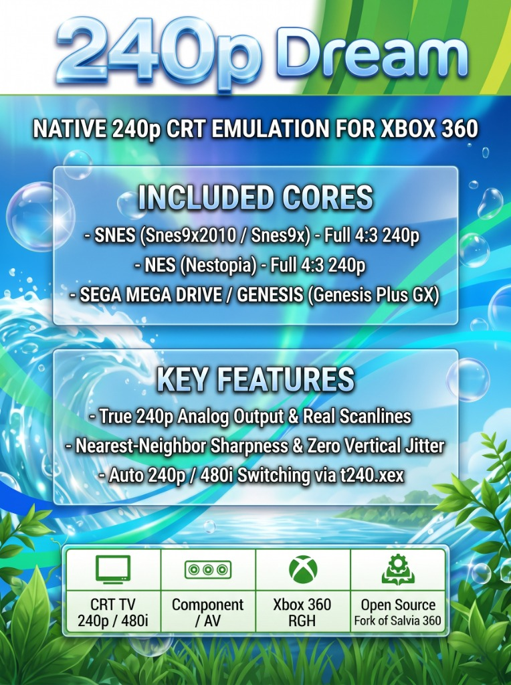

<p align="center">
  
</p>

<h1 align="center">Xbox 360 Native 240p — <code>t240.xex</code> (v2.30) &amp; 240p Dream</h1>

<p align="center">
  <strong>True 240p analog CRT output for Xbox 360 RGH + Plug-and-Play Retro Emulator</strong><br/>
  Created by <strong>tupapa2712</strong>
</p>

<p align="center">
  <em>"No matter how much others rely on logic, data, truth, and knowledge, I keep believing in myself."</em>
</p>

<p align="center">
  
  &nbsp;&nbsp;&nbsp;
  
</p>

---

## What is this?

Normally, when you connect an Xbox 360 to a standard-definition tube TV (CRT) using a Component, SCART, or AV cable, the console only outputs a flickering **480i** interlaced image.

This free, open-source project unlocks **real 240p progressive output** on Xbox 360 RGH — eliminating interlace flicker and delivering authentic black scanlines and razor-sharp pixels, so retro emulators and native Xbox 360 / XBLA games look just like original 15 kHz consoles on a CRT.

---

## What's New in v2.30

### 240p Dream (Updated to Salvia 360 v1.1.2 Base)
- **Updated Cores & Direct3D Acceleration:** Synced with **Salvia 360 v1.1.2**, adding updated cores (**Snes9x** with MSU-1, **Atari 2600 / Stella 2014**, **blueMSX**, **mGBA** with Direct3D acceleration), built-in BIOS downloader, and full true **240p** CRT output protection.
- **CRT-Ready Defaults Out of the Box:** Pre-configured for crisp 15 kHz CRTs (`2560x240` 4x Super-Resolution, `50 Hz PAL: Auto`, `Core Provided` aspect ratio, `Nearest Neighbor` scaling, `Integer Scale: On`, `Reduce Scale`, `Purple Drop` animated background, `Screen Resolution: Auto`).
- **Nintendo 64 (`xbox64`) 240p Fix:** Fixed viewport scaling and EDRAM render-target overlap so N64 games display properly framed, sharp, and uncropped in `2560x240` (with selectable `1x 320x240` / `2x 640x480` internal resolution).
- **Pre-Launch Core Options in Crisp 480i:** All **10 main cores** (`PlayStation PCSXR-360`, `Nintendo 64 xbox64`, `Snes9x`, `Snes9x 2010`, `mGBA`, `Genesis Plus GX`, `Nestopia`, `Gambatte`, `Stella 2014`, `blueMSX`) can now be configured directly from the **480i main menu (`Options → Core Options`) before launching a game** — no need to squint at menus in super-resolution during gameplay (`Select + Y` remains available in-game too).
- **PlayStation Controller Selector (`Digital` Default / `DualShock`) & Physical Rumble:**
  - PlayStation (`pcsxr-360`) defaults to **Standard / Digital Controller** and lets you switch Port 1 to **DualShock (Analog + Rumble)** right from **Core Options** before launching a game (or live in-game).
  - Real physical **XInput Rumble** enabled for both **PlayStation 1 (DualShock)** and **Nintendo 64 (Rumble Pak)**, with automatic motor stop when pausing or exiting.
- **New Instant Exit Combo:** Press **`LB + RB + LT + RT`** inside any retro game to exit immediately to the main menu, cleanly restoring **480i** and stopping controller vibration.

### `t240.xex` Plugin (Native Xbox 360 & XBLA Games)
- **Fixed `2560x240` Super-Resolution — Zero External Scripts:** No Aurora Lua script or external selector is needed anymore. Press **`LT + RT + L3 + R3`** inside any native Xbox 360 or XBLA game to toggle directly between **`2560x240`** and **`480i`**.
- **Zero On-Screen Popups:** Removed all on-screen notifications during video switches so nothing interferes with resolution transitions.
- **Stable Return to 480i & Transition Handling:** Snapshots and restores exact 480i CRTC/HANA sync with framebuffer re-latch when disabling 240p, eliminating uncontrolled 480i flicker without needing to open the Xbox Guide button.
- **Zero Latency Overhead:** Removed all background logging and frame-time telemetry; `t240.xex` performs zero framebuffer buffering and adds no input lag.

---

## Easy Setup & How to Use

### What You Need
* **Xbox 360 with RGH** (Kernel **17559**)
* **CRT TV** connected via Component, SCART, or AV cable (set Xbox display to **480i**)
* **DashLaunch** and **Aurora Dashboard**

> **IMPORTANT — Stealth Server Incompatibility:** `t240.xex` is **NOT compatible with Xbox Live Stealth servers**. Do not load it alongside any Stealth server plugin in `launch.ini`. This project is strictly for offline RGH/JTAG CRT use.
>
> **Note:** No copyrighted ROMs, BIOS files, or Xbox 360 SDK files are included. Bring your own legally dumped games and BIOS files.

### 3-Step Installation
1. **Download the files** from the [Releases](https://github.com/Tupapa2712/xbox360-240p-plugin/releases) page:
   * `t240-v2.30-plugin.zip` (or standalone `t240.xex`)
   * `240p-Dream-v2.30-Complete-NoROMs-NoBIOS.zip`
2. **Install `t240.xex`:**
   * Copy `t240.xex` to your console (e.g., `Hdd:\AuroraLaunch\Plugins\t240.xex`).
   * Open **DashLaunch** (or edit `Hdd:\launch.ini`) and assign a free plugin slot: `plugin3 = Hdd:\AuroraLaunch\Plugins\t240.xex`
   * Save and **reboot** your console.
3. **Install `240p Dream`:**
   * Extract `240p Dream` to your emulators folder (e.g., `Hdd:\Emulators\240p Dream\`).
   * Place your own RetroArch-compatible BIOS files in `240p Dream\system\` (see `BIOS_LIST.txt`) and your ROMs in the pre-created empty folders under `240p Dream\roms\<system>\`.
   * Scan your content paths in **Aurora** — cover art, banner, background, and icon load automatically.

### Quick Controls
| Where | How it Works | Button Combo |
| :--- | :--- | :--- |
| **240p Dream (Emulators)** | **100% Automatic.** Menus stay in crisp **480i**; games switch automatically to **240p**. | **`LB + RB + LT + RT`** *(exit game & return to 480i menu)* |
| **240p Dream (In-Game Menu)** | Optional in-game overlay menu (Core Options are also accessible before launch in 480i). | **`Select + Y`** *(open/close overlay menu)* |
| **Native Xbox 360 / XBLA** | Launch the game normally from Aurora in **480i**, then toggle in-game. | **`LT + RT + L3 + R3`** *(toggle **`2560x240`** ↔ **`480i`**)* |

### Important Rules & Tips
1. **Native Xbox 360 & XBLA — Loading Screens, Menus & Level Transitions:**
   - Launch native Xbox 360 and XBLA games from Aurora in **480i**, then press **`LT + RT + L3 + R3`** once in gameplay to engage **`2560x240`**.
   - **If a native 360 or XBLA game pauses or gets stuck on a loading screen, menu, character select, or level change while in 240p:** press **`LT + RT + L3 + R3`** to temporarily return to **480i** so the game can advance, then press **`LT + RT + L3 + R3`** again once gameplay resumes. The console does not detect or notify internal scene transitions while running in 240p mode.
2. **Do Not Use with Stealth Servers:** Always keep Stealth plugins disabled in `launch.ini` when using `t240.xex`.
3. **Powering Off Safely:** Return to **480i** before shutting down; if you press the physical power button while in 240p, wait 5–10 seconds for the watchdog to restore 480i and power off safely.

---

## Official v2.30 SHA-256 Checksums

<details>
<summary><strong>Click to expand: Official v2.30 SHA-256 Checksums</strong></summary>

| File | Size | SHA-256 |
|---|---|---|
| `t240.xex` (v2.30) | `102,400` B | `BF428062E2BAB19A144B117F051BCC5AB682240CF2C5F3BF1155808B129F7C50` |
| `t240-v2.30-plugin.zip` | `111,404` B | `2E1A4887220FA18F226DCA814D4B2DF76823FCED27B3F6F6A2C534727FE1BB1A` |
| `240p-Dream-v2.30-Complete-NoROMs-NoBIOS.zip` | `292,170,172` B | `CF8A9C62FC3A51BF6C4981682449C7A08E76B1FA52FB8E3099A4EF00318DF5A7` |
| `default.xex` (240p Dream) | `8,134,656` B | `5A9A33B7F6126CF9BAFBB313ED4E98BF7BF38C60391A6D157719AA075BC2B52E` |
| `pcsxr-360.xex` (PlayStation) | `23,425,024` B | `26EAC3B3CFA83DE343EBBCFE6183D024BAFE9394D7EEF526F1E3281B2CF82884` |
| `xbox64.xex` (Nintendo 64) | `9,244,672` B | `7D69B53C23E0CFD3E057AD0D141E3BBF825AA1F9042FAA7EA04819B8A17AFF5B` |
| `Snes9x.xex` (SNES MSU-1) | `10,371,072` B | `D9797172C6CFD096E342E3DF578EECB6DBA06CF76E295C28DA136DCB7429CFE1` |
| `Snes9x2010.xex` (SNES) | `10,432,512` B | `B8999CD6E281F287F0C93224EC49461AE141FD05EACE3B2B97A48273C5A33B4C` |
| `Nestopia.xex` (NES) | `11,317,248` B | `C7F87429D0FFAA798DA67FD8D3509F0C298963F2F32982B2F31275449E419958` |
| `Genesis-Plus-GX.xex` (Genesis/MD) | `12,378,112` B | `6737B3FA20E0F9449BF24961DF6DE21F1E2C12BEA1B43083CAB2021BEF932523` |
| `mgba.xex` (GBA D3D) | `9,908,224` B | `0C5CB158786403E195D34AC776C792B259D02114EF0878EC423AB70BC026ED23` |
| `Gambatte.xex` (GB/GBC) | `9,412,608` B | `B54BADC6E93D3A712EC2980BD96D83849630D561255CF795758BE33B5576A9BF` |
| `stella2014.xex` (Atari 2600) | `9,216,000` B | `0230FDFB64BFDE7285034DEEEFB2BB596FF949B158B52D7375544C53E30D82FE` |
| `blueMSX.xex` (MSX/MSX2) | `9,383,936` B | `7AAB323DB83C8F5FCAA4F212B09E1A0C6AEB8FDE65F0E909E43EB40FE5D9D5FC` |

</details>

---

## Building from Source

Requires the **Microsoft Xbox 360 SDK (XEDK)** and full **Visual Studio 2010** (Visual Studio Express is not supported):

```bat
build.bat
```

Outputs `build\t240.xex` (linked with `/DLL /BASE:0x81E00000` and `src\xex.xml`, zero static `xam.xex` imports).

## License & Credits

- **`t240.xex`:** Open-source Xbox 360 240p DashLaunch plugin by **tupapa2712**.
- **`240p Dream`:** CRT-focused fork of **[Salvia 360](https://github.com/danibiker/Salvia)** (v1.1.2) by **danibiker**, licensed under **GNU AGPL v3.0** (see `LICENSE` and `licenses/`).
